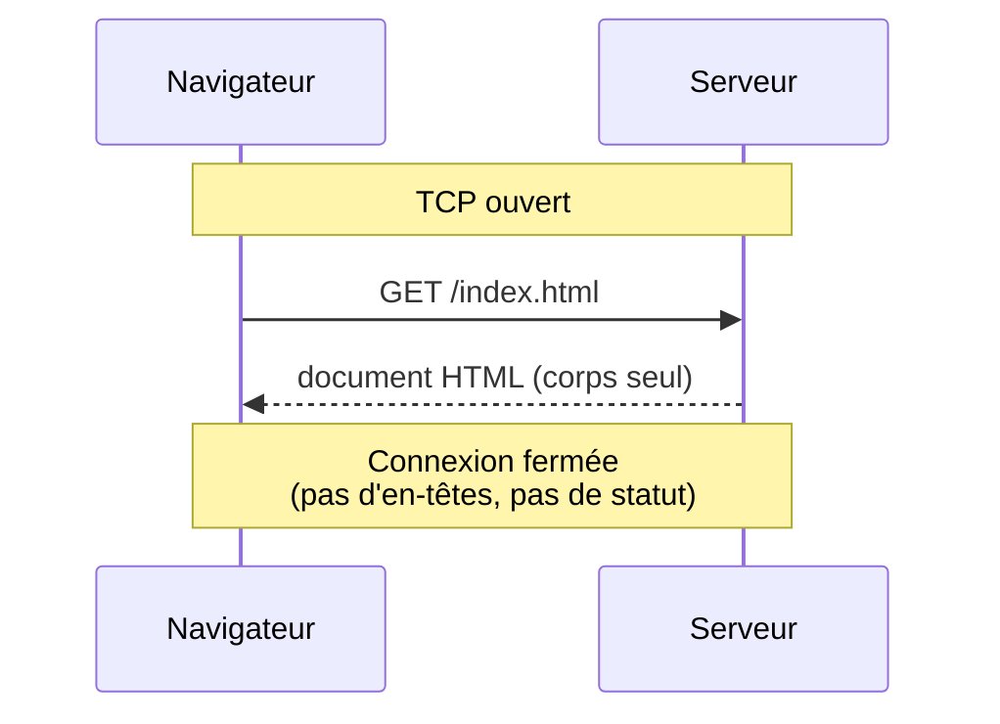
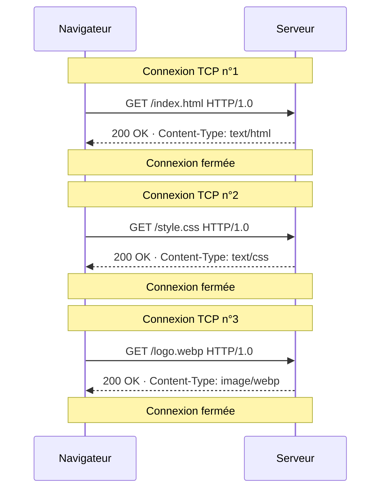
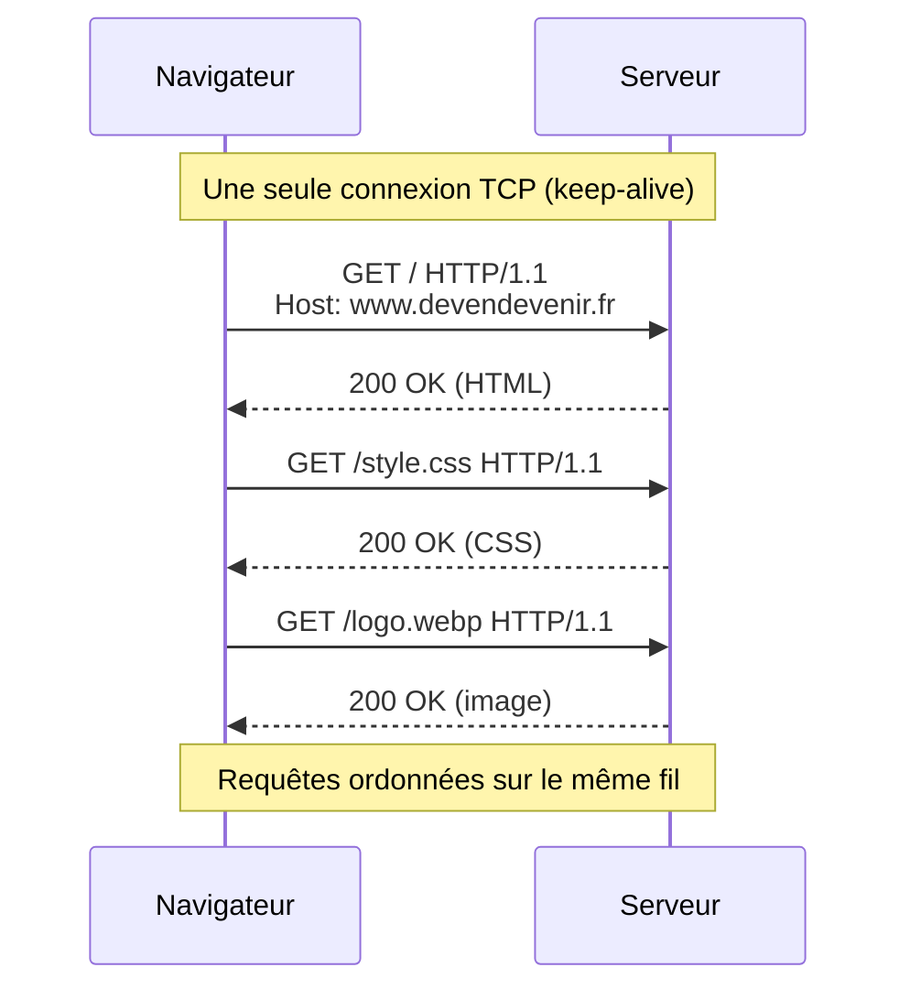
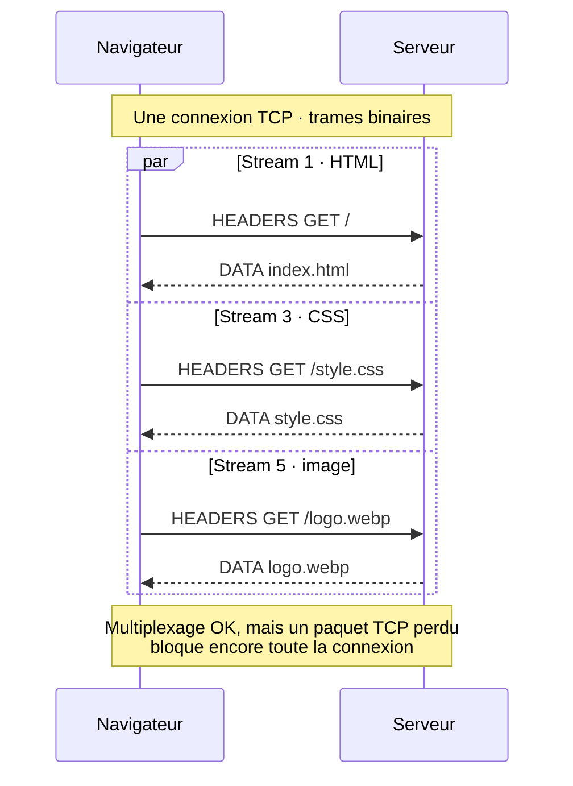
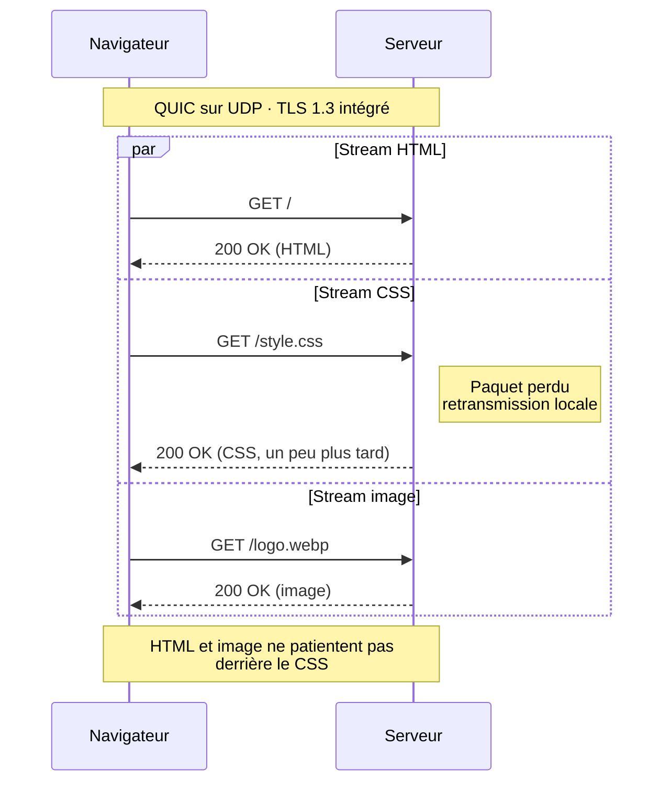

import Note from "@components/Note.astro";
import HttpExchangeDemo from "@components/HttpExchangeDemo.astro";
import HttpFlowDiagram from "@components/HttpFlowDiagram.astro";

Ce matin, j’ouvre DevEnDevenir. La barre d’adresse affiche une URL, la page se peint, les styles arrivent, le logo aussi. En apparence, rien ne s’est passé. En réalité, mon navigateur et un serveur viennent d’échanger une série de messages selon un protocole : **HTTP**, pour *HyperText Transfer Protocol*.

HTTP, c’est la convention qui dit comment demander une page, comment répondre, et quels métadonnées voyagent avec. Sans lui, HTML resterait un fichier sur un disque. Avec lui, ce fichier devient une ressource joignable sur le réseau.

Dans cet article, on suit toujours le même fil : charger la page d’accueil d’un site, puis ses fichiers liés (`style.css`, `logo.webp`). On verra d’abord ce qu’est un échange HTTP, puis la naissance du protocole au CERN, puis les grands sauts de version.

## C’est quoi, concrètement, un échange HTTP ?

HTTP décrit un dialogue **client → serveur**. Le client (souvent le navigateur) envoie une **requête**. Le serveur renvoie une **réponse**. Depuis HTTP/1.0, une requête typique contient :

- une ligne de commande (`GET / HTTP/1.1`) ;
- des **en-têtes** (métadonnées : hôte demandé, formats acceptés…) ;
- parfois un corps (pour un `POST`, par exemple).

La réponse commence par un **code de statut** (`200`, `404`, `301`…), puis ses propres en-têtes, puis le contenu.

<HttpExchangeDemo caption="Parcours guidé d’une requête GET sur la page d’accueil." />

<Note type="junior">
HTTP n’est pas le langage de la page : HTML décrit le document, CSS le style, JavaScript le comportement. HTTP, lui, transporte ces ressources d’une machine à une autre.
</Note>

## 1989–1991 : naissance au CERN

En 1989, au CERN, **Tim Berners-Lee** propose un système d’hypertexte sur Internet. En 1990, les quatre briques du web sont en place :

- HTML pour écrire les documents ;
- HTTP pour les échanger ;
- un navigateur (WorldWideWeb) ;
- un serveur (`httpd`).

Le 6 août 1991, Tim Berners-Lee annonce publiquement le projet sur le newsgroup `alt.hypertext`. On situe souvent là le démarrage public du World Wide Web.

La première version du protocole est si simple qu’on l’a surnommée plus tard **HTTP/0.9**, le « protocole à une ligne ».

## HTTP/0.9 : une ligne, un fichier HTML

Avec HTTP/0.9, la requête tient en une seule ligne. Pas de numéro de version, pas d’en-têtes, une seule méthode : `GET`.

```http
GET /index.html
```

La réponse, c’est directement le document HTML. Pas de code `200` ou `404` : en cas de problème, le serveur renvoyait souvent une page HTML expliquant l’erreur… pour un humain, pas pour un programme.



<HttpFlowDiagram version="0.9" caption="HTTP/0.9 : une requête, une réponse HTML, puis la connexion se ferme." />

Limite immédiate : on ne peut pas indiquer qu’on envoie une image, du CSS ou du JSON. Le web des débuts, c’est surtout du texte hyperlié.

## HTTP/1.0 : en-têtes, statuts, et d’autres types de fichiers

Entre 1991 et 1995, navigateurs et serveurs inventent des extensions « en live ». En novembre 1996, le **RFC 1945** documente les pratiques courantes sous le nom **HTTP/1.0**.

Trois ajouts changent la donne :

- la version apparaît dans la requête (`HTTP/1.0`) ;
- la réponse commence par un **statut** (`HTTP/1.0 200 OK`) ;
- les **en-têtes** permettent d’étendre le protocole, notamment avec `Content-Type`.

```http
GET /index.html HTTP/1.0
User-Agent: CERN-LineMode/2.15

HTTP/1.0 200 OK
Content-Type: text/html
Content-Length: 1374
```

On peut enfin transporter autre chose que du HTML. En revanche, chaque ressource a tendance à ouvrir **sa propre connexion TCP**. Pour une page + un CSS + une image, on paie trois fois le coût d’ouverture de connexion.



<HttpFlowDiagram version="1.0" caption="HTTP/1.0 : metadata riches, mais une connexion par fichier." />

## HTTP/1.1 : le protocole standardisé du web « classique »

**HTTP/1.1** est publié dès 1997 (RFC 2068, puis RFC 2616). C’est la version qui a porté le web pendant près de deux décennies. Parmi les changements majeurs :

- connexions **persistantes** (`keep-alive`) : on réutilise la même connexion TCP ;
- en-tête **`Host`** obligatoire : plusieurs sites peuvent partager la même IP ;
- **pipelining**, réponses **chunked**, meilleurs contrôles de **cache**, négociation de contenu.

```http
GET /style.css HTTP/1.1
Host: www.devendevenir.fr
Accept: text/css
Connection: keep-alive
```

Sur notre fil, la page HTML, le CSS et le logo peuvent voyager sur **une** connexion. Les requêtes restent toutefois largement **séquentielles** : on attend souvent la réponse précédente avant d’enchaîner vraiment librement. Le fameux *head-of-line blocking* au niveau HTTP commence ici à se faire sentir dès que le réseau rame.



<HttpFlowDiagram version="1.1" caption="HTTP/1.1 : une connexion réutilisée, des allers-retours encore ordonnés." />

## HTTP/2 : binaire, compressé, multiplexé

Publié en 2015 (**RFC 7540**), **HTTP/2** reprend la sémantique HTTP (méthodes, statuts, en-têtes) mais change le format sur le fil : on passe d’un protocole **textuel** à un protocole **binaire**, découpé en trames.

Les gains visibles pour notre page d’accueil :

- **multiplexage** : HTML, CSS et image circulent en parallèle sur une seule connexion ;
- compression des en-têtes (**HPACK**) ;
- priorité entre flux ;
- (historiquement) le *server push*, peu utiliséé aujourd’hui et retiré des plans majeurs des navigateurs.



<HttpFlowDiagram version="2" caption="HTTP/2 : plusieurs streams colorés sur la même connexion TCP." />

Un point subtil : HTTP/2 résout le blocage en tête de file **au niveau HTTP**. Mais si un paquet TCP est perdu, toute la connexion TCP attend — et donc tous les streams. Le goulot descend d’un étage.

## HTTP/3 : même HTTP, autre transport (QUIC)

**HTTP/3** (RFC 9114, 2022) garde encore la sémantique HTTP. Ce qui change, c’est le véhicule : fini TCP comme transport principal, place à **QUIC**, un protocole bâti sur **UDP**, avec chiffrement TLS 1.3 intégré au handshake.

Conséquence pour notre trio HTML / CSS / image : si le flux CSS perd un paquet, les flux HTML et image peuvent continuer. Chaque stream a sa propre gestion de perte. C’est la réponse au *head-of-line blocking* hérité de TCP.



<HttpFlowDiagram version="3" caption="HTTP/3 : multiplexage sur QUIC ; un flux peut ramer sans figer les autres." />

<Note type="info">
Dans les outils de développement du navigateur, l’onglet Réseau affiche souvent la version (`h1`, `h2`, `h3`) utilisée pour chaque ressource. C’est le meilleur moyen de vérifier ce que votre site parle vraiment en production.
</Note>

## Ce qui ne change (presque) pas

D’une version majeure à l’autre, on continue de penser en :

- méthodes (`GET`, `POST`, `PUT`…) ;
- URLs / chemins de ressource ;
- codes de statut ;
- en-têtes.

Ce qui évolue surtout, c’est **comment** ces messages sont découpés, multiplexés et transportés. HTTP/2 et HTTP/3 optimisent le tuyau ; ils ne remplacent pas la grammaire que lit un développeur dans l’onglet Réseau.

## Pour aller plus loin (volontairement hors sujet ici)

On laisse de côté, volontairement :

- le détail de HTTPS / certificats TLS ;
- la conception d’API REST ou GraphQL au-dessus de HTTP ;
- le réglage fin des caches (`Cache-Control`, CDN, ETag).

Ces sujets méritent leurs propres articles. Ici, l’objectif était plus simple : savoir ce qu’est HTTP, d’où il vient, et pourquoi « passer en HTTP/2 » ou « HTTP/3 » change la façon dont une page se charge — pas la façon dont on écrit une balise `<a href>`.

Quand vous rechargerez DevEnDevenir, ouvrez l’onglet Réseau, regardez la colonne de protocole, et rejouez mentalement les schémas de cet article. Vous verrez le même dialogue client ↔ serveur… accéléré par trente ans d’évolutions.
